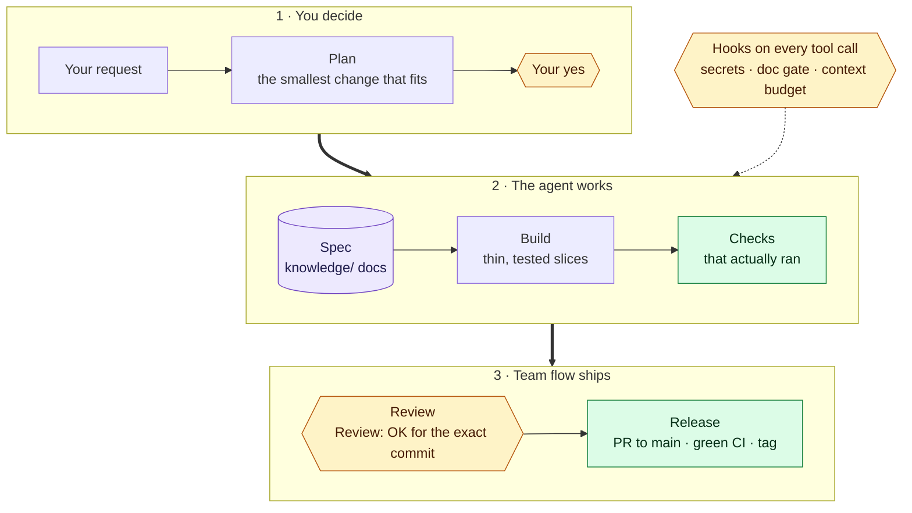

# Æion Template

[](https://github.com/OualidGuennif/aeion-template/actions/workflows/ci.yml)
[](https://github.com/OualidGuennif/aeion-template/releases)


[](LICENSE)

A repository template that teaches your coding agent how your project works, and stops it when it
tries something unsafe.

Start Claude Code, Codex, OpenCode or one of six other agents in it, and every session finds the same
setup: the project's rules in `AGENTS.md`, a step-by-step skill for each kind of task, a knowledge base
that says what the code must do, and hooks that check the work as it happens. It runs on Python 3 and
your agent, nothing else, and your own rules and decisions come first.

Coding agents write code faster than anyone can review it, and they lose instructions when their
context fills up. Here the rules that matter live in hooks, so they hold for the whole session. Once
your agent has loaded them, it cannot read `.env` or edit a file before reading the docs that cover
it. On the agents that expose compaction to hooks, it must also write a verified handover at 340k
tokens before it compacts. In the team flow, git
refuses a push of `develop` without a recorded review. A task is done when a check passed, and the
agent reports the checks it actually ran.

[New project](#start-a-new-project) · [Existing project](#existing-project) · [Optional tools](#enable-optional-tools) · [Skills](#skills) · [Hooks](#hooks) · [How it fits](#how-the-pieces-fit) · [Docs](#documentation)

## Start a new project

You need Git, Python 3.12+ and one installed, connected coding agent, on macOS, Linux or WSL.

1. On GitHub, [create a repository from this template](https://github.com/OualidGuennif/aeion-template/generate).
2. Clone it, reset it as a new project, and start your agent:

```bash
git clone https://github.com/<you>/<your-project>.git
cd <your-project>
tools/release/release --new-project
tools/agents/run claude
```

`--new-project` sets version 0.1.0, empties the changelog, leaves one task (adapt the template to
your project) and records the template release in `.aeion-template` for later updates. Then give
your agent the [ready-to-copy setup prompt](knowledge/operations/getting-started.md#new-project).

`tools/agents/run` takes any of the names below and installs nothing. Trust the project and approve
its hooks when your agent asks.

| Agent | Run | Hooks come from |
| --- | --- | --- |
| Claude Code | `claude` | `.claude/settings.json` |
| Codex | `codex` | `.codex/` (enable the hooks in `/hooks`, then restart) |
| OpenCode | `opencode` | `.opencode/` and `opencode.json` |
| Pi | `pi` | `.pi/` |
| DeepSeek Harness | `dsh` | `.dsh/` |
| Devin CLI | `devin` | `.devin/` |
| Droid (factory.ai) | `droid` | `.factory/` |
| Google Antigravity | `antigravity` | `.agents/hooks.json` |
| Grok | `grok` | `.grok/hooks/` |

To check that the hooks are loaded, ask the agent to run `cat .env`: it must be refused. The
[first-run setup per agent](knowledge/operations/getting-started.md#prepare-your-agent) covers the
rest.

You start in local mode. The safety hooks are on, and the git lifecycle (a `develop` branch, a review
before each push, a release pull request) stays off until you [enable the team git flow](#team-git-flow).

To try the template itself, clone `https://github.com/OualidGuennif/aeion-template.git` and run
`tools/agents/run claude` in it.

## Existing project

Open your project with your agent and use the adopt skill from a reference copy of Æion Template. It
looks at what you already have and proposes one phase at a time. Your instructions, tools and history
stay where they are, and nothing changes until you approve it. The
[existing-project walkthrough](knowledge/operations/getting-started.md#existing-project) has a
ready-to-copy prompt.

### Update to a new release

Run the update from an up-to-date clone of Æion Template (`git fetch --tags`), not from the project's
own copy of the tool. Preview first, then apply the latest release tag:

```bash
tools/agents/template-update --ref v4.1.0 --root ../your-project --check
tools/agents/template-update --ref v4.1.0 --root ../your-project
```

It finds the release your project came from (`.aeion-template`, else the closest tag), shows the
release notes, updates every template file you left untouched and merges the ones you edited. Your
instructions, settings, knowledge and changelog stay yours: you get a proposal for each. The
[template-update skill](.agents/skills/template-update/SKILL.md) walks your agent through it.

## Enable optional tools

Everything here is off until you turn it on. Run these commands yourself: the agent's guard refuses
to switch the flow mode or your settings for you.

| Option | What you get | Turn on |
| --- | --- | --- |
| [Team git flow](#team-git-flow) | Work on `develop`, checks before each commit, a recorded review before each push, releases by pull request to `main` | 4 commands below |
| [Framework mode](knowledge/components/framework-mode.md) | For projects specified with [aeion-framework](https://github.com/OualidGuennif/aeion-framework): the agent reads requirements from its service, and reading `@req`-annotated code loads them | `tools/aeion-settings framework <API address>` |
| Doc gate mode | `enforce` (default) refuses an edit until the covering docs were read; `warn` only reminds; `off` | `tools/aeion-settings doc-gate warn` |
| Claude Code plugins | Optional hook, skill, security and language-server tools | [Plugin commands](command.md#plugins-claude-code) |
| Scheduled loops | Recurring checks, reviews and approved tasks | [Loop setup](knowledge/operations/loops.md) |

### Team git flow

```bash
git config aeion.mode team                  # turn the team flow on for this clone
git config core.hooksPath tools/git-hooks   # pre-commit checks and the pre-push review gate
git switch -c develop                       # or: git switch develop, when it already exists
git push -u origin develop
```

From then on the agent works and commits on `develop`. Before each push it runs the pr-review skill,
and the pre-push hook refuses `develop` without a `Review: OK`. Releases go through the ship skill: a
pull request `develop → main`, merged after a green CI, then tagged. On GitHub, protect `main` so it
only takes pull requests with passing checks. [Agent workflow](Workflow_Agent.md) walks through the
whole flow.

Back to local mode: `git config --unset aeion.mode`. The pre-commit checks also work in local mode on
their own: run only the `core.hooksPath` line.

## Skills

A skill is a reusable procedure your agent follows for one kind of task. Ask for it in plain words
("Use the plan skill to prepare this change."); Claude Code also accepts `/plan`, and Codex `$plan`.

| You want to… | Skills |
| --- | --- |
| Pick task guidance, without launching agents | [skill-route](.claude/skills/skill-route/SKILL.md): native skills first, then an optional passive pool |
| Plan a change and define its behaviour | [plan](.claude/skills/plan/SKILL.md) · [spec](.claude/skills/spec/SKILL.md) |
| Implement, test or fix a bug | [build](.claude/skills/build/SKILL.md) · [test](.claude/skills/test/SKILL.md) · [debug](.claude/skills/debug/SKILL.md) |
| Update the docs and finish a task | [okf-update](.claude/skills/okf-update/SKILL.md) · [sign-off](.claude/skills/sign-off/SKILL.md) |
| Review and release (team flow) | [pr-review](.claude/skills/pr-review/SKILL.md) · [ship](.claude/skills/ship/SKILL.md) |
| Check a sensitive change | [security-scan](.claude/skills/security-scan/SKILL.md) |
| Adopt the template, or update to a new release | [adopt](.claude/skills/adopt/SKILL.md) · [template-update](.agents/skills/template-update/SKILL.md) |
| Triage findings, watch technical changes | [loop-triage](.claude/skills/loop-triage/SKILL.md) · [tech-watch](.claude/skills/tech-watch/SKILL.md) |
| Work from an aeion-framework spec (framework mode) | [framework](.claude/skills/framework/SKILL.md) |
| Keep feedback and improve the workflow | [pr-taste](.claude/skills/pr-taste/SKILL.md) · [retro](.claude/skills/retro/SKILL.md) |

The [command reference](command.md) lists every command and skill.

## Hooks

Agent hooks run inside your agent's session once it has loaded the project's hooks. Claude Code reads
`.claude/settings.json`, and the other agents get the same guards through the adapters in the table
above, within the limits [Agent compatibility](knowledge/operations/agent-compatibility.md) lists.

| Hook | Runs | What it does |
| --- | --- | --- |
| `session-start` | Session start, resume, compaction | Shows the mode, the doc gate and framework mode, branch, git status, last commits, open tasks and repo health |
| `doc-gate` | Before each edit; after each read | **Refuses** editing a file until the docs that cover it were read in the session (again after a compaction); in framework mode, also the briefs of its `@req` requirements |
| `guard-bash` | Before every shell command | **Refuses** secret reads (also through globs, and through recursive searches, links included), force-push, skipping git hooks, switching the flow mode or your settings, writing `.git/config`, unbounded dumps |
| `guard-path` | Before Read, Edit, Write, Grep | **Refuses** secret files (a link judged by its target), writing `.git/config` or `.aeion/settings.json`, oversized reads |
| `after-edit` | After each edit | Runs the fast checks for the edited file and names the doc that covers it |
| `context-budget` | Every event | At 340k tokens: a verified handover, then compaction; at 390k, both are forced. Devin and Antigravity have no compaction checkpoint, and Grok cannot refuse a compaction |
| `prompt-defense` | After web, MCP and network commands | Flags text that tries to steer the agent (advisory) |
| `token-feedback` | After tools, at stop | Flags tokens spent for nothing (advisory) |
| `sign-off` | When the agent stops (team flow) | Reminds once to update the covering docs and `work/current.md` |

Once enabled, the git hooks add two checks: `pre-commit` runs the knowledge, link and repo-health
checks, and `pre-push` (team flow) refuses `develop` without a recorded review and any direct push to
`main`. CI repeats the checks and scans for secrets, vulnerable dependencies and risky code on every
pull request and on pushes to `main` and `develop`.

## How the pieces fit



`AGENTS.md` sets the rules, `knowledge/` says what the product must do and how, a skill guides each
task, the hooks check the work as it happens, and `work/current.md` lists the open tasks. You approve
the plans that matter, and the agent reports the checks it actually ran.

### Principles

1. **Harmless.** What your repository already has wins; on conflict the template keeps yours and notes it.
2. **Plan first.** The agent inspects, proposes the smallest change that fits, and waits for your yes.
3. **Evidence, not claims.** Done means a check passed. Installed, configured, enabled and working are
   four different states.
4. **No over-engineering.** A file, tool or rule is added only when it removes a real, repeated cost.

### What the agent reads before an edit

The spec is your `knowledge/` folder, in the OKF format. Each code file names the doc that owns it,
and each doc lists the files it covers:

```python
#!/usr/bin/env python3
# Spec: knowledge/operations/context-safety.md
```

`doc-links --for` prints every doc that covers a file:

```bash
tools/knowledge/doc-links --for tools/context/budget.py
```

```text
knowledge/components/template-architecture.md
knowledge/operations/context-safety.md
```

Until the agent has read both in the current session, and again after a compaction, the
[doc gate](knowledge/components/doc-gate.md) refuses its edits to `budget.py`. With
`tools/aeion-settings doc-gate warn` it only reminds.

## Documentation

| Looking for… | Read |
| --- | --- |
| Setup per agent, adoption, troubleshooting | [Getting started](knowledge/operations/getting-started.md) |
| Commands and skills | [Command reference](command.md) |
| The team flow, step by step | [Agent workflow](Workflow_Agent.md) |
| Policies, specs and decisions | [Knowledge index](knowledge/index.md) |
| Agent configuration and known limits | [Agent compatibility](knowledge/operations/agent-compatibility.md) |
| Tests and checks | [Build and test](knowledge/operations/build-and-test.md) |
| Context limits and handovers | [Context safety](knowledge/operations/context-safety.md) |
| The doc gate, framework mode | [Doc gate](knowledge/components/doc-gate.md) · [Framework mode](knowledge/components/framework-mode.md) · [ADR-002](knowledge/decisions/ADR-002-framework-optional.md) |

## The Æion family

| Repository | Role |
| --- | --- |
| [aeion-framework](https://github.com/OualidGuennif/aeion-framework) | The method: AxiomSpec, a format for writing down what a product must do in one `spec.json` that a program can check |
| aeion-template (this one) | Makes the method executable in your repository; [framework mode](knowledge/components/framework-mode.md) connects the two |
| [aeion-core](https://github.com/OualidGuennif/aeion-core) | Still being built: a local web app that takes a feature from brainstorm to a checked specification |

Æion Template works on its own. Optional [Æion modules](https://github.com/OualidGuennif/aeion-spaceship/blob/main/docs/modules.md)
cover security, audit, observability and integration.

[MIT license](LICENSE) · [Credits](CREDITS.md) · [Security](SECURITY.md)
